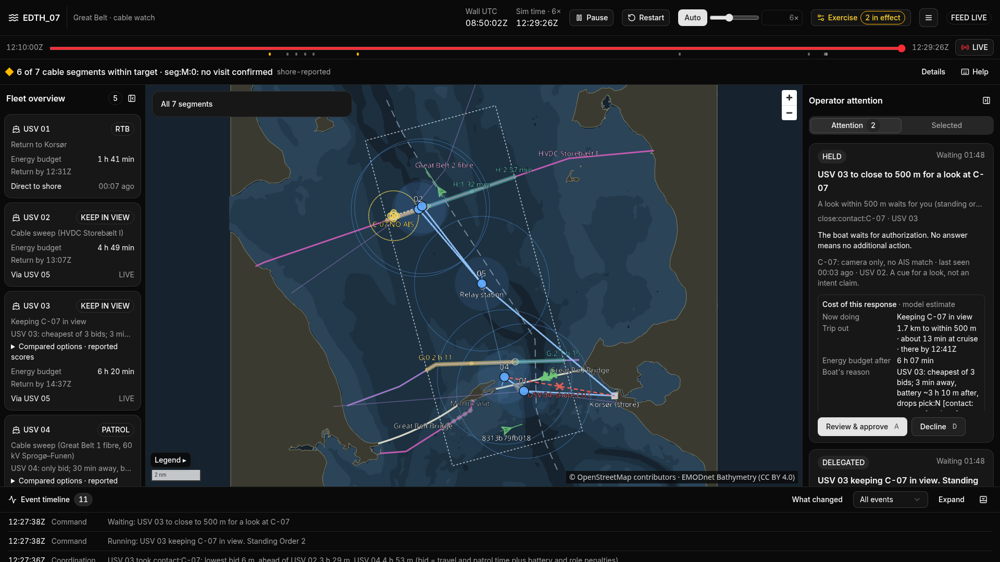
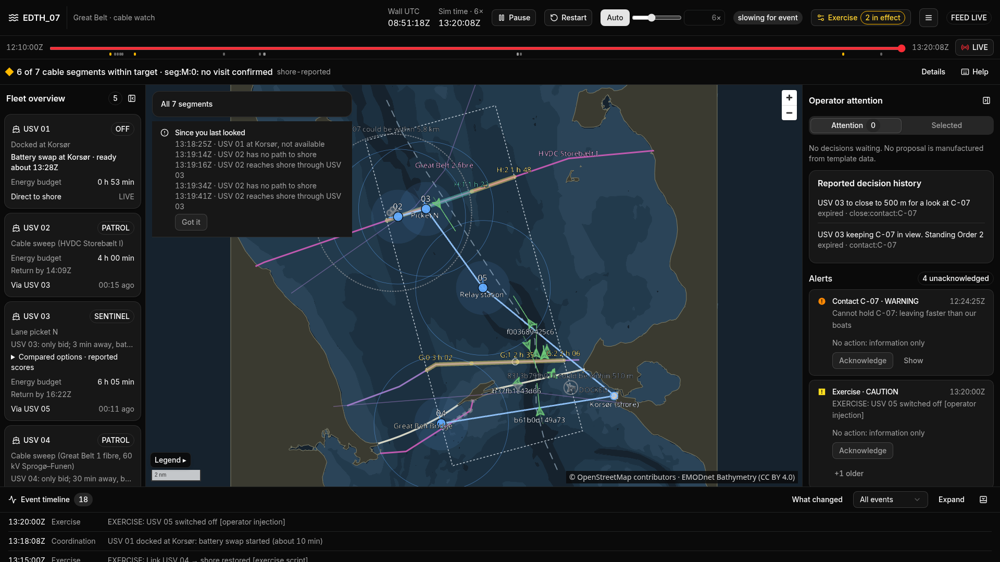

<div align="center">

# Pharos

**A swarm brain for small patrol boats that guard undersea cables, plus the shore console that keeps one watch officer in charge.**

*Fewer boats cannot close the gap, only choose where it lands.*

EDTH Copenhagen 2026 · Challenge 07: Swarm Coordination for Collaborative Missions · team Elysa's Secret




<sub>The shore console, demo preset, seed 1. USV 02 keeps an unidentified contact in view on the HVDC cable. Closing to 500 m for a look is held until the watch officer approves it.</sub>

</div>

---

## Why

Three power and data cables run under one of the busiest shipping lanes in Danish waters, the Great Belt. On Christmas Day 2024 the EstLink 2 cable in the Gulf of Finland failed at about 12:26; authorities first reached the suspected tanker by radio at 15:20. One cable fault can cost tens of millions of euros. (No court has ruled on guilt in that case.)

Small uncrewed surface vessels (USVs) can watch cables around the clock, but they fail in ordinary ways: a battery runs low, a radio link drops, a boat goes home. Someone has to reassign the work, or nobody does. A single watch officer covering a 25 × 10 km box cannot steer five boats by hand.

**Pharos lets the boats reorganise themselves when things break, and shows the operator exactly what is still uncovered.**

## What it does

- **No leader.** All five boats run the same code. They share one task table (cable segments, lane pickets, a radio relay station, contacts to keep in view), merge it over the radio and auction open work among themselves.
- **Repairs itself.** When a boat goes silent or returns to charge, its tasks reopen and the cheapest free boat takes them. Taking over a silent boat's cables needs a majority of the fleet, so a group cut off by the radio never steals the others' work.
- **Never hides the gap.** The console shows only what the radio actually delivered. Old data is greyed out with its age, never shown as live. If repair leaves a picket or a segment open, the console says so in words.
- **People decide what matters.** Watching is pre-approved; everything beyond watching waits for a person (see [standing orders](#standing-orders)).
- **Knows when to go home.** Each boat times its trip back along the water route, against the current it measures, with a 30 min reserve and a 1.2 × margin. It never bids on a task it could not finish and still get home.
- **Leaves an evidence trail.** What the shore received and decided is turned into a signed hash chain per boat (Ed25519). The console exports an incident report, and a tamper test names the exact record that was changed.

## How the swarm decides

Each boat follows the same short rule set ([`agent/RULES.md`](agent/RULES.md) has every rule with the constant behind it):

1. **Every task has one owner**: the boat that won it last.
2. **Heartbeat every 5 s**, passed on by other boats for up to 4 hops, so a boat out of shore range is still heard.
3. **Leases**: if the owner is silent for too long, the task reopens. That is 60 min for cables and pickets, and 60 s for the relay and a contact.
4. **Auction every 12 s.** Each free boat bids one task per round, in priority order: relay, contact, cables, pickets.
5. **The bid is a time**: travel to the task, plus the patrol loop with the task added, plus a penalty for low battery and for working outside the boat's role.
6. **The relay and a contact have a named backup** (the second-cheapest bidder), which takes over without a new auction.
7. **Idle boats rebalance** cable from an overloaded one, at most once every 5 min.
8. **After a takeover, sweep the stalest segment first.**

The agent code is deterministic: no wall clock, no global randomness, no unordered set iteration. Time comes in as an integer number of simulation milliseconds. Each boat sees only its own sensors and its radio inbox; `agent/` never imports the simulator or the evaluator.

### Standing orders

| Tier | Actions | Rule |
|---|---|---|
| Automatic safety | Return on battery reserve, release tasks | The boat acts, then reports. Cannot be stopped |
| Delegated | Keep a contact in view outside 1 nm, reassign segments, take over the relay | Starts at once. The operator can Confirm or Stop |
| Held for approval | Close to 500 m for a look | No answer means no action. The boat keeps watching |
| Authority only | Stop, board, detain, contact the flag state, assign blame | Not implemented, on purpose. The system only supplies the record |

A contact with no AIS match is a **cue for a look**, nothing more.

## Results

All five boats patrol the Great Belt box for a 3 h warm-up. Then boat 1 runs low on battery and goes home, a radio link is cut, and a synthetic dark contact appears on a cable. Three modes run on identical inputs and differ in one config key:

- `static`: fixed stations, no bidding.
- `off`: bidding stops at the failure.
- `elysa`: Pharos, repair stays on.

**30 paired seeds, same warm state per seed. Numbers are the evaluator's truth, not what the shore reported.**

| Truth, median (min to max) | `off` | `elysa` (Pharos) | Seed by seed |
|---|---|---|---|
| Cable km overdue at end | 6.7 (2.1 to 11.8) | **1.4** (0.0 to 5.6) | better in 30 of 30 |
| Mean km overdue, failure to end | 2.3 (0.5 to 4.6) | **0.2** (0.0 to 2.5) | better in 30 of 30 |
| Worst sample age at end (s) | 16,558 | **12,798** | better 24, equal 6, worse 0 |
| Failure to every segment owned by a live boat | never | **60 s** | |
| Real cargo and tanker crossings in view after the failure (of 9) | **9** | 5 (3 to 9) | worse in 20 of 30 |

**The trade-off, stated plainly.** Repair moves boat 4 off its south lane picket to the cables. The cables stay fresh, but fewer real ship crossings happen within camera range. In both modes the picket is empty; `off` keeps its crossings in view only because boat 4 never moves. Five boats cannot cover everything: Pharos chooses where the gap lands and shows it.

**Limits we measured.** With 4 km boat radios the gain shrinks (2.6 vs 4.9 km overdue) and the contact is never handed to a watcher. The contact is detected in only 10 of 30 seeds at 2.3 m/s, depending on where the sweeper is in its loop.

Numbers from `main` at `86806cb` (7 Nov 2026). Full tables, sensitivities and the exact commands are in [`eval/results.md`](eval/results.md). The agent changed after that revision, so re-run the batch before you quote a number:

```bash
uv run python -m eval.run_batch --modes off,elysa --seeds 1,...,30 --jobs 8 --out runs/paired30
```

## Quick start

You need [uv](https://docs.astral.sh/uv/), Node.js LTS and pnpm. Everything runs offline once installed.

```bash
git clone https://github.com/elysassecret/EDTH_07.git && cd EDTH_07
uv sync                                     # Python 3.12 and all dependencies
pnpm --dir web install --frozen-lockfile
pnpm --dir web build                        # build the console once
```

Run the demo: the real simulator and the console on one port.

```bash
uv run python -m server --serve-web --demo
```

Open **http://localhost:8765/** and press **Run**. The scripted demo takes about 2.5 minutes: a low battery and reassignment, a link cut with store-and-forward, a contact kept in view, an approval card, the relay boat switched off, and a relay takeover. The shot list is in [`server/DEMO.md`](server/DEMO.md).

| Also try | Command or URL |
|---|---|
| Evaluator view (truth next to the shore picture) | http://localhost:8765/?evaluator |
| Launch from harbour: five boats leave Korsør and share out the work | `uv run python -m server --serve-web --demo server/launch.toml` |
| 3D maritime viewer of the same run (port 8766) | `uv run python -m world.viewer --port 8766` |
| Replay a run log and check it hash by hash | `uv run python -m server.replay runs/<file>.jsonl` |
| Inject your own failure | **Exercise** button in the console, pick a boat |



<sub>After the relay boat is switched off: boats the shore cannot hear show how old their data is, and the alert list says what happened.</sub>

## Tests

```bash
uv run ruff check .
uv run pytest -q tests/smoke     # fast, run before every PR
uv run pytest -q                 # full suite, takes several minutes
```

The suite covers the agent rules, the message contract, the simulator, the server and the evaluator. It also includes story tests that replay the demo beats. Every run writes a JSONL log with periodic state hashes, so a seed plus its list of injected commands rebuilds the run exactly.

## Architecture

```text
┌──────────────────────── one Python process (server/) ────────────────────────┐
│  world/   sim clock ─► motion · battery + current · sensors · radio channel    │
│      │                         ▲ inbox bytes only          │ outbox bytes     │
│      ▼                         │                           ▼                  │
│  agent/ × 5 boats    each boat: own sensors + radio inbox ─► decisions         │
│  ais/     replay of a real AIS day, evaluator only                            │
│  eval/    metrics from the run log (never imported by agent/)                 │
│  server/  snapshot ─► WebSocket /shore (delivered data only)                  │
│                     ─► WebSocket /truth (evaluator)                           │
│           ◄─ commands: confirm · stop · approve · decline · inject             │
└───────────────────────────────────────────────────────────────────────────────┘
                 │ ws://localhost:8765, JSON, 10 Hz
                 ▼
        web/   React + MapLibre + deck.gl console, offline map and satellite layer
```

| Folder | What |
|---|---|
| [`agent/`](agent/) | The swarm brain on each boat: task table, merge, leases, auction, tours, relay, contacts, energy |
| [`contract/`](contract/) | Shared messages and snapshot shape: pydantic, exported to JSON Schema and TypeScript |
| [`world/`](world/) | Simulator: integer motion, current and tide, battery, sensors, modelled radio, coastline routing, 3D viewer |
| [`ais/`](ais/), [`scenarios/`](scenarios/) | Real AIS replay and the scripted event tapes |
| [`server/`](server/) | WebSocket bridge, alerts, narrator, run log and replay |
| [`web/`](web/) | Operator console (TypeScript, React, MapLibre, deck.gl, Zustand) |
| [`evidence/`](evidence/) | Per-boat signed hash chain and incident report |
| [`eval/`](eval/) | Metrics, three-mode baseline, fairness checks, scorecard |
| [`tools/`](tools/) | Scene checks; coastline, depth and satellite preparation |
| [`deck/`](deck/), [`docs/`](docs/) | Pitch, operator guide, plans and research |

## Real versus modelled

| Real | Modelled |
|---|---|
| Great Belt geography and coastline (OpenStreetMap) | Radios: range, loss, delay |
| Public approximate cable lines (OpenStreetMap) | Current, tide and battery |
| Shipping lane measured from one AIS day (3 Nov 2026, anonymised) | The dark contact (synthetic) |
| Sentinel-2 satellite image and EMODnet depth | A 2D sea with no sea state |

This is a simulation. A sea trial needs a permit or a defence operator. The AIS data is not in the repository; the boats never see it. Only the evaluator reads it.

## Where it could go

The software runs on a retrofit box of off-the-shelf parts (compute module, mesh radio, AIS, LTE, GNSS). The box talks MAVLink to any ArduPilot boat, and the autopilot keeps its own safety behaviour. Our estimate is EUR 2,500 to 4,500 per hull. The buyer and market reasoning, with sources, is in [`deck/DECK.md`](deck/DECK.md).

## Team

Built in one weekend at EDTH Copenhagen, 6 to 8 November 2026.

| | Role |
|---|---|
| Javier Arévalo ([@emermelada](https://github.com/emermelada)) | Swarm brain and message contract |
| Simeone ([@SimeDev42](https://github.com/SimeDev42)) | Simulator, AIS and scenarios |
| Alexandru ([@zytzev](https://github.com/zytzev)) | Operator console, server and evidence |
| Franco ([@FearedLynx](https://github.com/FearedLynx)) | Evaluation, tests and pitch |

## Credits

Map data © OpenStreetMap contributors (ODbL). Contains modified Copernicus Sentinel data. Bathymetry: EMODnet (CC BY 4.0). AIS: Danish Maritime Authority, anonymised.
